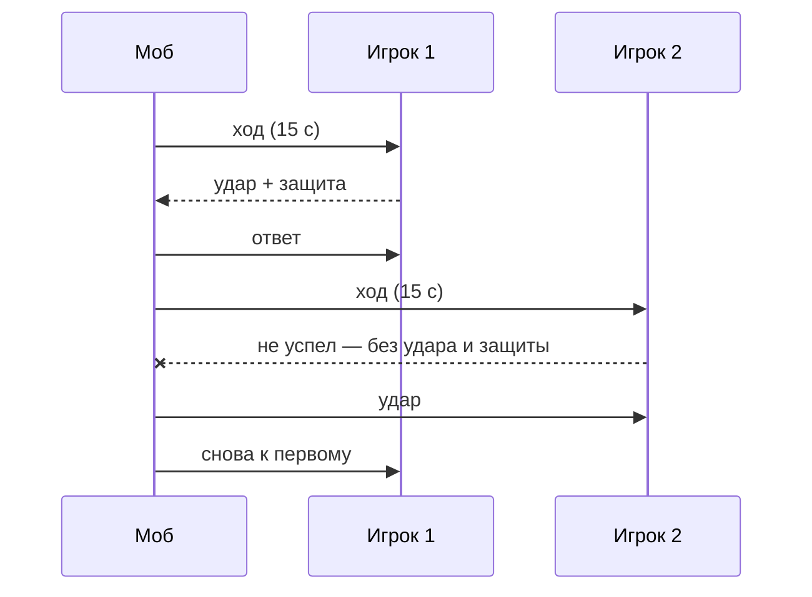

# Мобы-легенды и рейды

Идея дизайнера (18.11.2026), правила собраны из ответов на [[Открытые вопросы]] п. 45–47.
Решения — [[Решения MVP]] №75–88. Тестировать — во время беты.

## Обычные мобы (как сейчас)

Моб создаётся у каждого игрока свой, на 5 минут, другие его не видят ([[Решения MVP]] №49).
С 5 уровня игрока моб бывает от −2 до +2 уровней (№74), сильнее на 20% за каждый уровень (№75).
Мобы выше уровнем тоже могут напасть внезапно.

## Как моб становится легендой

- **Сетка уровней**: 1–5, 6–10, 11–15, 16–20. Легенда растёт только до верха своей сетки
  (моб 3 уровня — не выше 5, моб 7 уровня — не выше 10).
- Считаются только **разные** игроки — «откормить» моба друзьями или вторым аккаунтом нельзя.
- Убийства игроков в 🚶 Оффлайне тоже считаются, но **легенда видна только игрокам в 📡 Онлайн**:
  после превращения она исчезает у Оффлайн-игроков. Рейды — только вживую.
- Легенда получает имя по жертвам (например, «Мародёр-людоед»), уровень и число жертв видны на метке с черепом.

## Трофей

- Проигравший легенде теряет вещи как обычно; **80% из них моб забирает**, 20% пропадают.
- Моб носит не больше **N вещей** (`legend_trophy_max`, старт — 20), лишнее пропадает.
- Крышки проигравших (10% с собой, №121) тоже уходят в трофей — **до 3 000 крышек** на легенду (`legend_caps_max`), сверх — пропадают.
- Убили моба — жертвы среди участников рейда сначала получают **свои** вещи, остальное — по вкладу.

## Поведение

- Мобы **выше 5 уровня бродят по району** и могут нападать сами.
- Мобы 5 уровня и ниже стоят на месте и сами не нападают — новички в безопасности.
- Агрессия легенды — радиус 100 м, но не на игроков ниже её уровня на 3 и больше.
- Слух по району: всем онлайн-игрокам района — «🐀 Крысы шепчутся: в районе А-2 бродит Мародёр-людоед, 4 жертвы» + награда за голову.

## Рейд

- Участвовать — только **📡 Онлайн**, ближе 50 м, не больше **10 участников**.
- Здоровье моба +60% за каждого участника сверх первого — толпа невыгодна.
- **Бой по очереди**: моб дерётся с одним игроком, остальные ждут, пока он «подойдёт» к ним.
  На ход игрока — **15 секунд**. Не успел — не бьёт и не защищается (уворот работает), моб бьёт.
  Потом моб идёт ко второму, третьему… и снова к первому. Так же — рейд на босса.
- Награда — по вкладу (урону), минимум 5% урона; бонус за добивание.

## Боссы — только рейдовые

**Личных боссов нет** (№86): один на один босс верха сетки для игрока в её начале — почти верная смерть.
Боссы — **рейдовые**: общие для всех, видны только в 📡 Онлайне, до 10 участников, бой по очереди.
- Уровень босса — **верх сетки**: 1–5 → 5, 6–10 → 10, 11–15 → 15, 16–20 → 20 (№76).
- Сами не нападают — только метка; игроки собираются и начинают рейд.
- **Где и когда** (№88): по одному боссу каждой сетки на район, в случайном спец-объекте района, раз в 6 часов;
  ждёт 2 часа, при появлении — слух по району; не убили — уходит.
- **Награда**: по вкладу (урону) + **гарантированный эпичный предмет** каждому, кто нанёс ≥ 5% урона.

## Мобы 11–20 (пакет мобов v1, 22.11)

Решения — [[Решения MVP]] №132–133. Раньше после 12 уровня мобов не было: игрок 16 уровня встречал Гуля 12-го, с 17-го — никого.
Числа — **на минимальном уровне моба**, рост **8% за уровень** (у старых мобов — 20%). Всё правится в админке.

| Сетка | Моб | Код | Ранг | Уровни | Здоровье | Урон | Опыт | Частота | Образ |
|---|---|---|---|---|---|---|---|---|---|
| 11–15 | Бешеный кабан | `boar` | обычный | 11–15 | 170 | 15–25 | 320 | 25 | Спустился с предгорий, бьёт с разбега |
| 11–15 | Рейдер | `raider` | обычный | 11–15 | 140 | 17–27 | 320 | 20 | Мародёры сбились в банду и вооружились |
| 11–15 | Чумные сурки | `plague_marmots` | обычный | 11–15 | 100 | 19–30 | 300 | 15 | Мало здоровья, больно кусают (сурки — реальные переносчики чумы в горах) |
| 11–15 | Горный волк | `mountain_wolf` | элита | 11–15 | 330 | 20–32 | 420 | 6 | Крупнее и хитрее Вожака стаи |
| 11–15 | Санитар | `orderly` | элита | 12–16 | 350 | 21–34 | 670 | 5 | Бывший медик в противогазе, бродит у больниц |
| 16–20 | Фонящий ходок | `glowing_walker` | обычный | 16–20 | 220 | 22–35 | 3 000 | 20 | Пережил [[Радиационные штормы\|шторм]], светится в темноте |
| 16–20 | Як-мутант | `mutant_yak` | обычный | 16–20 | 330 | 17–28 | 3 000 | 20 | Много здоровья, бьёт слабее остальных |
| 16–20 | Наёмник | `mercenary` | обычный | 16–20 | 190 | 25–39 | 3 000 | 15 | Профи: самый сильный удар среди обычных |
| 16–20 | Шатун | `shatun` | элита | 16–20 | 420 | 26–42 | 4 400 | 6 | Медведь, не уснувший после катастрофы |
| 16–20 | Химера Сектора Б | `sector_b_chimera` | элита | 17–20 | 400 | 28–45 | 7 000 | 5 | Сбежала из лаборатории — отсылка к «Ключ-карте Сектора Б» |
| 16–20 | **Хозяин Сектора Б** | `sector_b_master` | рейд-босс | 16–20 (всегда 20) | 1 100 | 36–58 | 25 000 | — | Босс сетки 16–20, только рейдом |

Босс сетки 11–15 — прежний **Мутант-громила** (15 ур.). Лут — по рангу, как у старых мобов.
Национальных символов среди мобов нет.

**Симуляция** (по 2000 боёв, у игрока лучшие вещи пакета v1, очки 45% сила / 35% здоровье):

| Бой | Побед | Потеря здоровья |
|---|---|---|
| Игрок 13 — обычный 13 | 100% | −18…22% |
| Игрок 13 — элита 13 | 95% | −57% |
| Игрок 13 — элита 15 | 80% | −67% |
| Игрок 18 — обычный 18 | 100% | −24…29% |
| Игрок 18 — элита 18 | 92–96% | −54…60% |
| Игрок 18 — Шатун 20 | 70% | −70% |
| для сравнения: игрок 10 — Гуль 12 (сейчас) | 92% | −59% |

> [!done] В игре с 22.11 (разработка)
> Миграция `0024`: все 11 мобов в таблице «Мобы» (админка), рост за уровень — колонка «Рост за уровень, %» (8%),
> у старых мобов она пустая — действует общая настройка 20%. Хозяин Сектора Б заведён с частотой 0 — сам не появляется,
> ждёт рейдов (бета). Значки на карте: 🐗 🪓 🐿️ 🐺 😷 · ☢️ 🐂 🎯 🐻 🧬 · 👁️.

> [!warning] Вещи после 10 уровня
> Сейчас самые сильные вещи — 10 уровня, после 10-го игрок растёт только очками. Мобы посчитаны под это.
> Нужен **пакет предметов для 11–20**; когда он появится — подтянуть мобов 16–20 в админке.

## Для разработки

| Что | Где |
|---|---|
| Мобы мира: таблица `world_mobs` (вид, уровень, ранг, здоровье, жертвы, трофей, район, позиция, маршрут, до какого времени) | миграция |
| Счётчик побед моба над **разными** игроками → превращение в легенду | `mobs.py` при поражении игрока |
| Брожение по району и агрессия — отдельный воркер (раз в 5–10 с), он же — таймер 15 с хода в рейде | новый сервис `world.py`, docker-compose |
| Очередь рейда: `raid_participants` (порядок, вклад, последний ход), общее здоровье — атомарное списание | миграция, `raid.py` |
| Клиент: полоса здоровья и очередь ходов — опрос раз в 1–2 с (позже WebSocket) | `app.js` |
| Слух по району — уведомление в Mini App и сообщение ботом | `app/bot`, `world.py` |
| Расписание рейд-боссов: таблица или `world_mobs` с `rank = boss`; воркер раз в `raid_boss_interval_h` ставит босса каждой сетки в случайный спец-объект района, снимает через `raid_boss_lifetime_h` | `world.py`, `game_settings` |

---
Связанные темы: [[Сбор припасов (Глобальные)]] · [[Кланы]] · [[Районы]] · Разработка: [[Игровой цикл MVP]]
