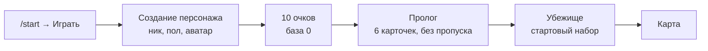
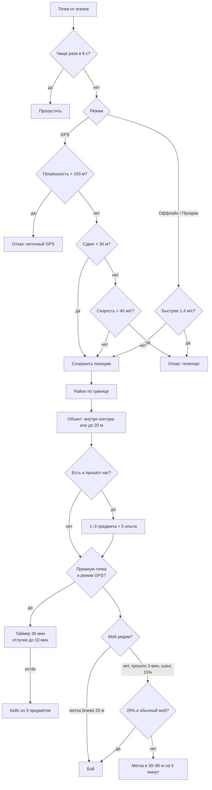
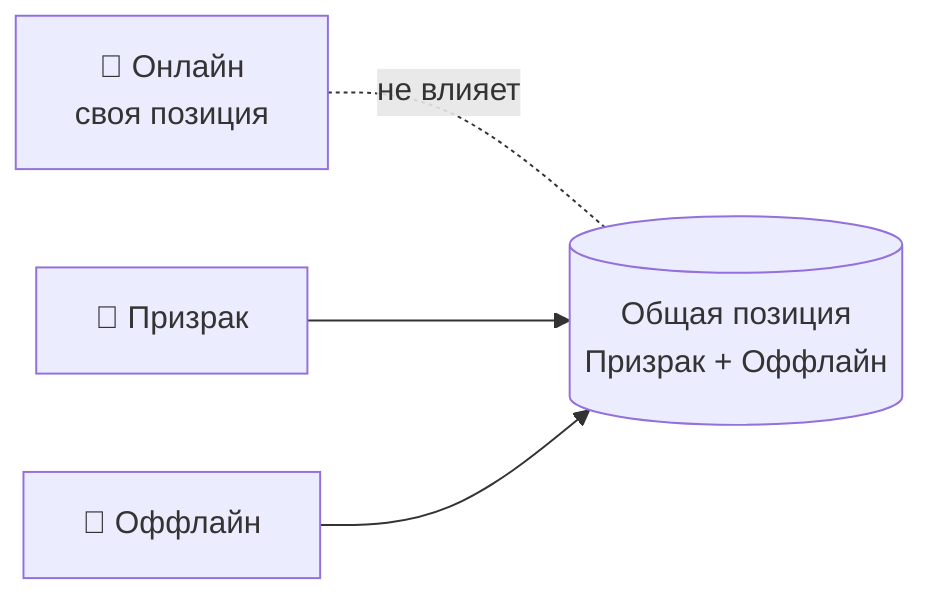

# Игровой цикл MVP

## Путь игрока

На карте: аватар игрока, границы районов, объекты вокруг (цвет по типу, золотые —
премиум, серые — уже обысканы). Сверху — уровень, опыт, район. Переключатель
«📡 Онлайн / 🚶 Оффлайн / 👻 Призрак». Сверху же — полоса здоровья. Снизу — меню (см. ниже).

## Что происходит при каждой точке

В режиме Призрака после «Сохранить позицию» и района — всё: лута, премиум-точек и мобов нет.

Клиент шлёт точку, если сдвинулся на 15 м или прошло 50 секунд (пульс для таймера бара).

## Три режима передвижения

> **Названия режимов (18.11, [[Решения MVP]] №84):** 📡 **Онлайн** — живой GPS (раньше «📡 GPS»);
> 🚶 **Оффлайн** — ходьба тапом; 👻 **Призрак** — присутствие без добычи. В старых решениях до 17.11
> «Онлайн» означал нынешнего Призрака.

| | 📡 Онлайн | 🚶 Оффлайн | 👻 Призрак |
|---|---|---|---|
| Для кого | ходит по городу | не может ходить физически | хочет видеть других и быть видимым |
| Как | настоящие шаги | тап → «Идти сюда? N м, ~M мин» → идёт | тап → идёт; телепорт к своей базе |
| Скорость | любая до 40 м/с | всегда 1,4 м/с | всегда 1,4 м/с |
| Лут и опыт | да, все грейды | да, все грейды | **нет** |
| Мобы | да | да | нет |
| Премиум-точки | да | да | нет |
| Основать базу | да | да | нет |
| Видит игроков рядом («👥 Рядом») | да | **нет** | да |
| Виден другим в «👥 Рядом» | нет | нет | **да** |

**👻 Призрак** (бывший «Онлайн», переименован 17.11) — режим присутствия: игрок виден другим,
ходит тапом с той же скоростью, что Оффлайн, телепортируется к своей [[#База|базе]], но не
лутает и не встречает мобов. Скорость одна с Оффлайном — значит, «доехать Призраком и лутать
Оффлайном» не быстрее, чем просто идти Оффлайном. «👥 Рядом» — только Призраки, 200 м, без
расстояний, в случайном порядке: GPS и Оффлайн никому не видны.

## Где стоит персонаж

- **Призрак и Оффлайн делят одну позицию.** Дошёл Призраком или телепортировался к базе →
  включил Оффлайн → идёшь оттуда. И наоборот.
- **GPS — отдельная позиция**, общую не двигает. Только самый первый раз, когда общей позиции
  ещё нет, она берётся из последней GPS-точки (или с Ала-Тоо).
- **Вышел из игры в оффлайне** — последняя точка отправляется на сервер; при входе игра открывается
  в оффлайн-режиме на том же месте.
- При первом включении оффлайна — окно-объяснение («Больше не показывать»; повторное нажатие
  на «Оффлайн» — показать снова). Цель пути отмечается флажком 🏁.

## База

- Одна на игрока, основать во вкладке «🏠 База», стоя у здания (GPS или Оффлайн), своё название 2–32 символа.
- Любое здание, включая школы. Нельзя: бары/кафе, парки, больницы, заправки, военные объекты,
  премиум-точки (список — `game_settings.base_forbidden_kinds`, правится в админке).
- В одном здании до 10 баз разных игроков (`base_max_per_building`).
- На карте — 🏠 с названием. В режиме Призрака — кнопка «🏠» телепорта.
- Пока база — только точка телепорта; склад и защита — позже.

## Мобы и бои (17.11)

Подробно и с числами — README кода, раздел «Мобы и бои». Коротко:
- Моб появляется **только в GPS и Оффлайне**, случайно, **не чаще раза в 3 минуты** (ответ дизайнера),
  если здоровье не ниже половины. Обычно — **метка на карте** в 30–80 м на 5 минут: подошёл
  ближе 20 м — бой. Обычный моб с шансом **25% нападает сразу**; элита и босс — никогда внезапно.
- **Раунд** ([[Открытые вопросы]] №15): выбираешь удар и защиту (голова / торс / ноги), моб — случайно;
  удар в защищённую зону — блок. Урон — от силы и оружия, броня одежды гасит урон своей зоны,
  ловкость — уворот, удача — крит ×2.
- **Сбежать**: 30% + 3% за ловкость. Не вышло — моб бьёт без ответа.
- **Победа**: опыт и лут по рангу ([[Открытые вопросы]] №11).
- **Поражение** (ответ дизайнера): −1…3 вещи из рюкзака, −1 надетая вещь, −10% опыта уровня.
- **Здоровье** = 50 + 10 × «Здоровье», восстанавливается само за 30 минут.
- У каждого игрока свой моб; бой считает сервер. Все числа — в `game_settings` (админка).

## Нижнее меню (17.11)

🏠 База · 🧍 Персонаж · **🗺 Карта** (большая, по центру) · ⚔ Клан (серый, «скоро») · 🛒 Магазин (серый, монетизация).
«Персонаж» — фигурка в полный рост с анимацией (дыхание, моргание, покачивание оружием),
надетые вещи нарисованы на ней; 5 слотов — тап → надеть/снять; характеристики; рюкзак.

**Ограничение Telegram:** GPS идёт, только пока Mini App открыт на экране. Заблокированный
телефон = нет точек; через 10 минут таймер бара сбросится.

Подробнее о луте — [[Лут и прогрессия]].

---
Назад: [[Обзор разработки]]
