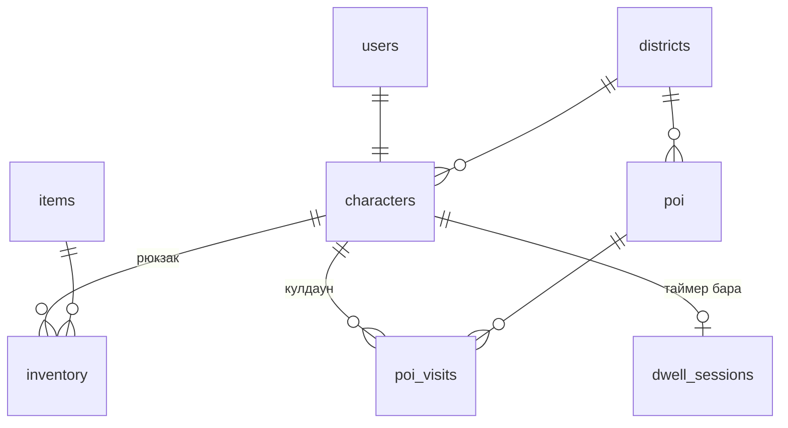

# Модель данных

## Игроки

| Таблица | Что хранит |
|---|---|
| `users` | аккаунт Telegram |
| `characters` | никнейм, пол, аватар, когда зарегистрирован и прошёл пролог; уровень, опыт, очки, 5 характеристик; режим (`real` GPS / `walk` Оффлайн / `virtual` Призрак); **последняя** GPS-позиция и общая позиция Оффлайна и Призрака; **здоровье** (`hp`, пусто = полное) и когда записано; когда был последний моб; **ходьба при закрытой игре** (№91): цель 🏁 `walk_to_lat/lon`, скорость `walk_speed`, сколько обыскано и найдено без игрока `walk_bg_searched/found`; `auto_walk` — включён ли 🤖 Авторежим (без него сервер не ведёт) |
| `inventory` | предмет и количество, надет ли (в слоте — один надетый предмет), `new_count` — сколько штук ещё не просмотрено (вкладка «🆕 Новое», 19.11) |
| `bases` | база игрока (одна): здание (пусто — упакована для переезда), название, когда основана; уровни `workbench_lvl` / `storage_lvl` / `medbay_lvl` (0 — не построен); переезды (`moved_at`, `moves`), бесплатная аптечка (`medkit_day`) |
| `character_materials` | 6 материалов игрока — счётчики вне рюкзака (№113) |
| `base_storage` | склад базы: предмет и количество; принадлежит игроку, при поражении не теряется (№111) |
| `poi_visits` | когда игрок обыскал объект — для кулдауна 1 час |
| `dwell_sessions` | таймер премиум-точки: с какого момента и когда последний раз был на месте |
| `loot_log` | журнал добычи: находки, кейсы, бои, уровни, переполнение, лимит Оффлайна — окно «📜 Журнал» (20 последних) и статистика беты |
| `mob_spawns` | моб-метка рядом с игроком (одна): какой моб, уровень, где, до какого времени ждёт |
| `fights` | идущий бой (один): моб, уровень, его здоровье, номер раунда, было ли внезапное нападение; `player_hp` — здоровье игрока в бою (без регена) и `last_action_at` — для доигрывания брошенного боя (19.11) |
| `inventory.belt_slot` | ячейка пояса 1–3 (№94); `fights.belt_used` — какие ячейки уже использованы в бою, `fights.buff_*` — действующий бафф Стимулятора |
| `markets` | 6 рынков и **лавки выживших** (`kind = post`, №135: открыта до / закрыта до, причина, общий запас `stock`); у рынка: точка, радиус, что берут дороже (`buy_filter`, ×`buy_mult`), что продают (`sell_filter`) |
| `market_purchases` / `market_orders` | купленное игроком за день у рынка / выполненные заказы дня; `characters.caps` — крышки |
| `traders` / `trader_purchases` | бродячие торговцы (имя, реплики, районы или маршрут, ассортимент — админка; `spot_*` — где старьёвщик в эту смену) / покупки у них |
| `collection` | «🏅 Коллекция» (№104): какие коллекционные вещи нашёл игрок; в `inventory` не попадают |
| `server_errors` | ошибки сервера (500): адрес, текст, след — админка «Ошибки сервера» |
| `premium_claims` | полученные кейсы премиум-точек: кто, какая точка, когда — для лимита 3 в сутки и 24 ч на точку (19.11) |

## Карта

| Таблица | Что хранит |
|---|---|
| `districts` | 4 района: код A-1…A-4 (не меняется), название (по умолчанию «Район А-N»), граница |
| `poi` | объекты: тип, название, **точка и контур**, район, **`is_premium`** и **`dwell_minutes`** |

## Справочники — можно править прямо в базе

| Таблица | Что внутри | Подхватится |
|---|---|---|
| `levels` | 20 уровней: опыт до следующего, очки за достижение | до 1 минуты |
| `items` | предметы: название, грейд, уровень, категория, слот, **урон** (оружие), **броня** (одежда), `source_kind` (тип объекта для спец-лута; пусто — обычный лут), `droppable` (стартовые вещи не выпадают) | до 1 минуты |
| `loot_chances` | шансы грейдов: `source` (`object` или `box`), диапазон уровней, грейд, % | до 1 минуты |
| `game_settings` | числа игры «ключ = значение»: опыт за объект, кулдаун, шансы спец-лута, удача, размер кейса, отлучка из бара, радиус и окно «Рядом», правила базы, параметры игрока для боя | до 1 минуты |
| `base_levels` | цена достижения уровня модуля (1 — постройка), рубежные вещи, число (ячейки / ×восстановления), эффект | до 1 минуты |
| `recipes` | 13 рецептов Верстака: уровень, результат, ингредиенты «код:штук» | до 1 минуты |
| `base_move_phrases` | фразы переезда: модуль или пусто («без потерь») | до 1 минуты |
| `mobs` | мобы: ранг (обычный/элита/босс), уровни появления, здоровье, урон, опыт, частота, сколько лута каждого грейда, вкл/выкл, `level_scale_pct` — свой рост за уровень (пусто — общая настройка, №133); 18 мобов, уровни 1–20 | до 1 минуты |

Всё это правится в **админке** `/admin` (вход по `ADMIN_PASSWORD` из `.env`). Контуры
зданий и районов там не правятся — только импортом карты.

Тестовые мобы (миграция `0002`): Уличный кот, Дикая собака, Крыса-мутант, Мародёр, Вожак
стаи (элита), Гуль (элита), Мутант-громила (босс).

Тестовые предметы (54 шт., уровни 1–10, все 5 грейдов) — в миграции `0001`.

## Правила

- Данные (строки) можно менять как угодно.
- Структуру (колонки, таблицы) — **только через миграцию Alembic**. Руками `ALTER TABLE`
  не делать: на другой базе этого изменения не будет.
- История перемещений не хранится — только последняя точка.
- `poi.osm_id` = id из OpenStreetMap × 10 + тип (0 точка, 1 контур, 2 отношение).

---
Назад: [[Обзор разработки]]
