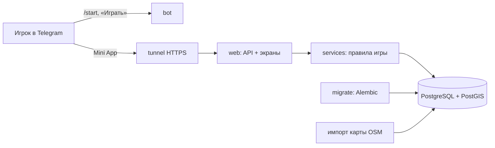

# Техническая архитектура

## Сервисы

| Сервис | Зачем |
|---|---|
| db | база: игроки, карта, справочники |
| migrate | создаёт и обновляет таблицы ([[Модель данных]]) и завершается |
| web | Mini App: экраны и API, через который экраны общаются с сервером |
| tunnel / ngrok | HTTPS-адрес — Telegram открывает Mini App только по HTTPS. `quick` (cloudflared) — адрес меняется при перезапуске; `ngrok` — постоянный `buckle-french-evoke.ngrok-free.dev`. Выбор — `COMPOSE_PROFILES` в `.env` |
| bot | `/start` и кнопка «Играть»; сам узнаёт адрес у туннеля |

## Стек

| Компонент | Зачем |
|---|---|
| Python 3.12 | язык сервера |
| aiogram 3 | бот |
| FastAPI | API Mini App |
| PostgreSQL + PostGIS | база с геозапросами («в каком районе», «что в 20 м») |
| Alembic | миграции — изменения структуры базы без потери данных |
| MapLibre + OpenFreeMap | карта в Mini App, бесплатно и без ключей; **с 3D-картой — своя подложка** (№108) |
| PMTiles (план, №108) | подложка Бишкека одним файлом `bishkek.pmtiles` на нашем сервере: Caddy отдаёт куски файла (HTTP Range), MapLibre читает их через плагин `pmtiles`; стиль, шрифты и значки — тоже свои статичные файлы |
| HTML + JavaScript без сборки | экраны Mini App |
| cloudflared | HTTPS-туннель для теста с ноутбука |

## Слои

- **web / bot** — тонкие: получили запрос → вызвали сервис → вернули ответ.
- **services** — правила игры. Не знают о Telegram и HTTP. Вся математика (лут, уровни,
  таймер бара, античит) — чистые функции с тестами.
- **core** — подключение к базе и модели.
- **Справочники** (уровни, предметы, шансы) — в базе, не в коде: правятся без программиста.

## Безопасность

- Каждый запрос Mini App подписан Telegram (initData). Сервер проверяет подпись токеном
  бота — подделать чужой id нельзя.
- Токен бота — только в `.env` (не в git и не в образе Docker).
- Режим `DEV_AUTH` (вход без Telegram) — только для отладки на своём компьютере.

---
Назад: [[Обзор разработки]]
