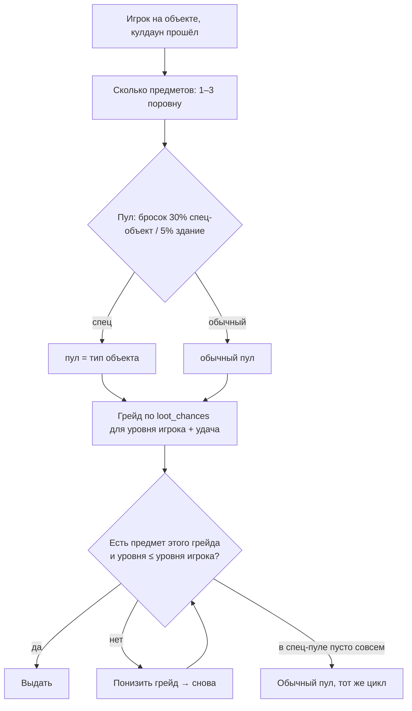

# Экономика лута

Разбор 17.11.2026: как лут работает в коде сейчас, что реально выпадает и как довести это до
понятной модели. Цифры «сейчас» получены симуляцией настоящего `app/services/loot.py` на
предметах из миграции `0001` (40 000 обысков на каждый случай).
Правила, которые уже в коде, — [[Лут и прогрессия]]. Решения по этой заметке → [[Открытые вопросы]] п. 30–37.

## 0. Статус (17.11, вечер)

Приняты п. 30, 31, 32, 34, 36, 37 и кейс только в GPS → [[Решения MVP]] №50–56.
Изменения против текста ниже: удача — **+0,1 п.п. за очко** вместо относительного бонуса (п. 4.5);
окно уровня — **только для снаряжения** (п. 4.1).
Решено позже: три класса предметов — снаряжение / расходники / хлам (№57); в Оффлайне легендарный → эпичный
и лимит 200 обысков в день (№58–59) — это вариант A из п. 4.6 плюс лимит. Ждёт ответа: 33а в [[Открытые вопросы]].
18.11: спец-пул на спец-объекте **60%** вместо 30% (№60); инвентарь и сброс — [[Инвентарь]] (№61–72).
Удача (№67): +0,1 п.п. за очко **поровну** между открытыми редкими грейдами — заменяет п. 4.5.
**18.11 (вечер) — сделано в коде** (миграция `0004`, 111 тестов): шансы v2, пустые обыски, спец-пул 60%,
выбор предмета без искажений (тот же грейд в общем пуле до понижения), окно уровня для снаряжения, кейс 5 с
гарантированным редким+ и только в 📡 Онлайне, удача поровну, Оффлайн — легендарный → эпичный (и с мобов) и лимит
200 обысков, классы предметов, `loot_log`, рюкзак с ячейками и сумками ([[Инвентарь]]), уровни и опыт мобов.
**Не сделано из раздела 5:** торговцы и «крышки» (№68), скрипт отчёта `loot_report.py`. Дыры контента — раздел 6.

## 1. Как работает сейчас (по шагам)

## 2. Что реально выпадает

Доля выпавших предметов по грейдам, %. Об = обычный, Нб = необычный, Рд = редкий, Эп = эпичный, Лг = легендарный.

| Где | Уровень | Таблица обещает (Об/Нб/Рд/Эп/Лг) | Выпадает на деле |
|---|---|---|---|
| Здание | 1–2 | 49 / 21 / 15 / 9 / **6** | **100** / 0 / 0 / 0 / 0 |
| Здание | 3 | 49 / 21 / 15 / 9 / 6 | 49 / **51** / 0 / 0 / 0 |
| Здание | 4 | 49 / 21 / 15 / 9 / 6 | 49 / 21 / **30** / 0 / 0 |
| Здание | 5–7 | 56 / 24 / 10 / 7 / 3 | 56 / 24 / 10–20 / 0–10 / **0** |
| Здание | 10 | 49 / 21 / 20 / 9 / 1 | 49 / 21 / 20 / 9 / 1 ✅ |
| Больница | 1 | — | 100 / 0 / 0 / 0 / 0 |
| Больница | 10 | — | 56 / **15** / 20 / 9 / 1 |
| Кейс | 1 | 56 / 24 / 10 / 7 / 3 | 80 / 0 / **20** / 0 / 0 |
| Удача 0 → 30, ур. 10 | | | редкие+ 29,7% → 30,0% (не видно) |

Таблица честно работает только с 10 уровня. До этого игрок видит совсем не то, что настроено в админке.

## 3. Проблемы

| # | Проблема | Почему так | Важность |
|---|---|---|---|
| Л1 | На 1–4 уровне таблица обещает 6% легендарок, а их 0%: легендарные предметы есть только с 8 уровня | грейд режется уровнем предмета, понижение съедает шанс | 🔴 |
| Л2 | Понижение грейда искажает таблицу: на 3 уровне 51% «необычных» (весь редкий/эпик/легендарный уходит в фонарик и кроссовки) | `pick_item` понижает грейд, а не ищет тот же грейд в другом пуле | 🔴 |
| Л3 | Легендарки падают по мере роста уровня: 6% → 3% → 1% | так заданы ответы п. 14 | 🔴 дизайн |
| Л4 | В спец-пулах нет «необычного» вообще → в больнице, на заводе и т. д. он превращается в «обычный» | контент: в миграции нет предметов | 🟡 |
| Л5 | Удача не ощущается: 0,01 п.п. за очко, 30 удачи = +0,3 п.п. | ответ п. 20 | 🟡 дизайн |
| Л6 | Кейс за 30 минут в баре (3 предмета, в основном обычные) слабее 30 минут ходьбы (~60 объектов, ~120 предметов) | размер кейса и шансы | 🔴 дизайн |
| Л7 | «🚶 Оффлайн» с дивана даёт столько же, сколько реальная прогулка, включая премиум-кейс. Это противоречит [[Геолокация и оффлайн онлайн передвижения]]: «самые ценные награды — только при реальном перемещении» | решение №30 | 🔴 дизайн |
| Л8 | Предметы любого уровня ≤ уровня игрока: на 15 уровне всё ещё падают зубные щётки, пул размывается | нет нижней границы | 🟡 |
| Л9 | Каждый объект даёт 1–3 предмета, пустых нет: рюкзак забивается хламом, находка не радует | 1–3 поровну | 🟡 |
| Л10 | Нет журнала выпадений: на бете не узнать, что игроки реально получают | история не хранится | 🟡 техника |
| Л11 | Лут с мобов (`combat.roll_mob_loot`, с 17.11) берёт предмет тем же `pick_item` — те же искажения: у элиты на 5 уровне «эпичная» ячейка отдаёт редкий нож (эпичных предметов в обычном пуле до 6 уровня нет) | общий `pick_item` | 🟡 — чинится вместе с Л2 |

**Прогрессия (для контекста).** 5 опыта за объект; при ~2–3 объектах в минуту пешком:
5 уровень — 23 объекта (~10 мин), 10 уровень — 493 (~3–4 ч), 15 уровень — 9 369 (~60 ч),
20 уровень — 177 тыс. объектов (больше, чем зданий в городе). Начало быстрое, после 12-го — стена.
Мобы и события должны давать основной опыт после 10 уровня — заложить при их балансе.

## 4. Предлагаемая модель v2

### 4.1 Порядок броска (что меняется в коде)

1. **Пусто или нет** — у обычного здания есть шанс «ничего не нашёл» (опыт всё равно даётся).
2. **Сколько предметов** — по весам, а не 1–3 поровну.
3. **Пул** — спец (30% / 5%) или обычный. Без изменений.
4. **Грейд** — по таблице уровня, затем удача, затем модификатор режима (GPS / Оффлайн).
5. **Предмет** — грейд сохраняем: сначала ищем **тот же грейд** в спец-пуле, затем в обычном,
   и только если нигде нет — понижаем. Уровень предмета — окно `[уровень − 4; уровень]`, если пусто — расширяем вниз.

### 4.2 Шансы грейда на объекте (`loot_chances`, source = object)

Грейды открываются по уровням. Легендарки — с 5 уровня, как в [[Уровни]] («с 5 уровня начинается
возможность дропа»). Каждая строка в сумме 100.

| Уровень | Обычный | Необычный | Редкий | Эпичный | Легендарный |
|---|---|---|---|---|---|
| 1–2 | 75 | 22 | 3 | 0 | 0 |
| 3–4 | 63 | 27 | 8 | 2 | 0 |
| 5–9 | 55 | 27 | 12 | 5 | 1 |
| 10–14 | 47 | 28 | 16 | 7 | 2 |
| 15–20 | 40 | 29 | 20 | 8 | 3 |

Чем выше уровень, тем лучше лут: исправляет Л1 и Л3.

### 4.3 Сколько предметов на объекте

| Объект | 0 | 1 | 2 | 3 | В среднем |
|---|---|---|---|---|---|
| Обычное здание, бар | 40% | 45% | 15% | — | 0,75 |
| Спец-объект | — | 50% | 35% | 15% | 1,65 |

Спец-объекты становятся целью маршрута, а не случайностью. Ключи: `loot_count_building`, `loot_count_special`
(формат `0:40,1:45,2:15`).

### 4.4 Кейс премиум-точки (source = box)

Обычных в кейсе нет, минимум необычный; **один слот из кейса — гарантированно редкий или выше**.

| Уровень | Необычный | Редкий | Эпичный | Легендарный |
| ------- | --------- | ------ | ------- | ----------- |
| 1–4     | 60        | 30     | 10      | 0           |
| 5–9     | 50        | 32     | 14      | 4           |
| 10–20   | 40        | 35     | 18      | 7           |

Размер кейса — 5 (`box_size`). Сравнение на 5–9 уровне: 30 минут ходьбы ≈ 45 предметов,
из них ~2 эпичных и ~0,5 легендарного; кейс ≈ 5 предметов, ~1 эпичный и ~0,25 легендарного,
и он гарантирован. Кейс выигрывает качеством, ходьба — количеством.
Позже — эксклюзивный пул кейса (`source_kind = 'box'`), которого нет на улице.

### 4.5 Удача

Вместо +0,01 п.п. — **относительный бонус**: веса редкий/эпичный/легендарный × (1 + 1% × удача),
недостающее забирается у «обычного». Потолок — удача 50 (+50%).
На 5–9 уровне: удача 0 → редкие+ 18%; удача 10 → 19,8%; удача 30 → 23,4%. Видно, но не ломает баланс.
Ключ: `luck_rare_mult_pct = 1`.

### 4.6 GPS и Оффлайн

Варианты для п. 35 [[Открытые вопросы]]:

| Вариант | GPS | 🚶 Оффлайн | Плюс | Минус |
|---|---|---|---|---|
| A (рекомендую) | всё | легендарный → эпичный; премиум-кейс недоступен | соответствует дизайну «ценное — только вживую» | Оффлайн чуть беднее |
| B | редкие+ × 1,25 | как сейчас | мягко | разница почти не видна |
| C | как сейчас | как сейчас | проще всего | выходить на улицу незачем, кроме скорости |

### 4.7 Требования к контенту предметов

Правило для таблицы `items`: в каждом пуле (обычный + 10 спец) — минимум 1 предмет каждого грейда,
открытого на этом уровне. Сейчас дыры:

| Пул | Чего не хватает |
|---|---|
| обычный | редкий до 4 ур., эпичный до 6, легендарный до 8 |
| все спец-пулы | **необычный — ни одного** |
| больница, школа, военный, завод | легендарный только с 8–10 ур. |
| магазин, университет, стройка, заправка, склад, парк | легендарного нет |

После правила из 4.1 п. 5 дыры спец-пула закрывает обычный пул того же грейда. Но тогда в больнице
вместо «редкого медицинского» выпадет «редкий нож» — лучше заполнить.

## 5. Что сделать в коде (для разработчика)

| Задача | Где |
|---|---|
| Миграция `0003`: новые строки `loot_chances` (object и box), ключи `game_settings`: `loot_count_building`, `loot_count_special`, `luck_rare_mult_pct`, `box_guaranteed_min_grade = rare`, `item_level_window = 4`, `walk_max_grade = epic`; `box_size = 5` | `migrations/versions/0004_loot_v2.py` (0003 — бои, уже есть) |
| `pick_item`: сначала тот же грейд в другом пуле, потом понижение; окно уровня. Лут мобов использует его же — исправится автоматически | `app/services/loot.py`, проверить `combat.py` |
| `roll_object_loot`: количество по весам, режим игрока → `max_grade` (у `roll_grade` параметр уже есть) | `app/services/loot.py`, `movement.py` |
| `roll_box`: гарантированный слот редкий+ | `app/services/loot.py` |
| `apply_luck`: относительный множитель | `app/services/loot.py` |
| Таблица `loot_log` (игрок, тип объекта, режим, грейд, предмет, время) для беты | миграция + `movement._give` |
| `special_chance_special_pct = 60` (№60). Инвентарь: `inventory_base_cells = 20`, `stack_size = 20`, слот `back` и колонка `items.bag_cells`, подсчёт занятых ячеек, отказ при переполнении, «выбросить N / все / весь хлам» (№62–66) | миграция `0004`, `inventory.py`, `movement._give`, `app.js` |
| Удача: `luck_grade_bonus_pct = 0.1`, `luck_split = equal/proportional`; бонус только в грейды с шансом > 0 на уровне игрока (№67) | `loot.apply_luck`, `game_settings` |
| Торговцы: тип объекта `market` из OSM (`amenity=marketplace`) или ручная отметка в админке; `characters.caps`; цены `sell_price_<грейд>`; API «продать N» (№68) | миграция, `scripts/osm.py`, новый `trade.py`, `app.js` |
| Ячейки от Силы: `cells_per_strength = 10`, считать по распределённой Силе (№69) | `inventory.py` |
| Журнал добычи: последние 20 записей `loot_log` игрока, событие «рюкзак переполнен»; всплывашка над персонажем (№71–72) | `api.py`, `movement.py`, `app.js` |
| Уровень моба (№74): `mob_level_offsets = -2:10,-1:20,0:40,1:20,2:10`, `mob_level_spread_from = 5`; пул мобов — чей диапазон пересекает [ур. − 2; ур. + 2]; до 5 уровня — ровно уровень игрока. Дополнения — после ответа на п. 45 | `combat.choose_mob`, `combat.mob_level`, `game_settings` |
| Колонка `items.item_class` (`gear` / `consumable` / `junk`), заполнить по `category`/`slot`; окно уровня в `pick_item` — только для `gear`; рюкзак и админка — с фильтром по классу (№57) | миграция `0004`, `loot.py`, `inventory.py`, `admin.py`, `app.js` |
| Оффлайн: `max_grade = epic` при `mode == walk`; счётчик обысков за сутки (по `poi_visits` за сегодня или поле в `characters`), лимит `walk_daily_search_limit = 200` (№58–59) | `movement.py`, `game_settings` |
| Тест-«статистика»: 20 000 бросков, фактические доли в пределах ±1 п.п. от таблицы на всех уровнях 1–20 | `tests/test_loot.py` |
| Скрипт отчёта: фактическое распределение из текущей базы (то, что настроено в админке) | `scripts/loot_report.py` |
| Опыт с мобов под решение №55: сейчас Мародёр 10 уровня даёт ~19 опыта при 1 984 до 11 уровня (~100 боёв на уровень). Нужен рост опыта моба с уровнем как у таблицы уровней (×1,5–1,8 за уровень), а не +10% | `mob_level_scale_pct` / отдельный ключ для опыта, `combat.scale_mob` |

Всё, что помечено «дизайн» в разделе 3, — только после ответа в [[Открытые вопросы]].

## 6. Дыры контента после лута v2 (симуляция на настоящих предметах, 18.11)

Алгоритм проверен тестом: при полном наборе предметов доли грейдов совпадают с таблицей на всех 20 уровнях
(±1 п.п.). На текущих 59 предметах так — с 6–8 уровня. Ниже грейд понижается, потому что предмета нет:

| Уровень | Здание: таблица → на деле (Об/Нб/Рд/Эп/Лг) | Чего не хватает |
|---|---|---|
| 1 | 75/22/3/0/0 → **100**/0/0/0/0 | необычного и редкого 1 уровня (в общем пуле и спец-пулах) |
| 3 | 63/27/8/2/0 → 63/37/0/0/0 | редкого и эпичного ≤ 3 ур. в общем пуле |
| 5 | 55/27/12/5/1 → 55/27/18/0/0 | эпичного ≤ 5 и легендарного ≤ 5 |
| 6–7 | … → легендарный 0% | легендарного ≤ 7 (сейчас первые — 8 ур.) |

Для [[Обучение]] шаг 3 («первый обыск — гарантированно необычный») нужен необычный предмет 1 уровня.
Решение — пакет предметов: по каждому пулу хотя бы один предмет каждого грейда с уровня, где грейд открывается
(необычный — 1, редкий — 1, эпичный — 3, легендарный — 5). Разработка может предложить список.

---
Назад: [[Обзор разработки]] · [[Лут и прогрессия]]
